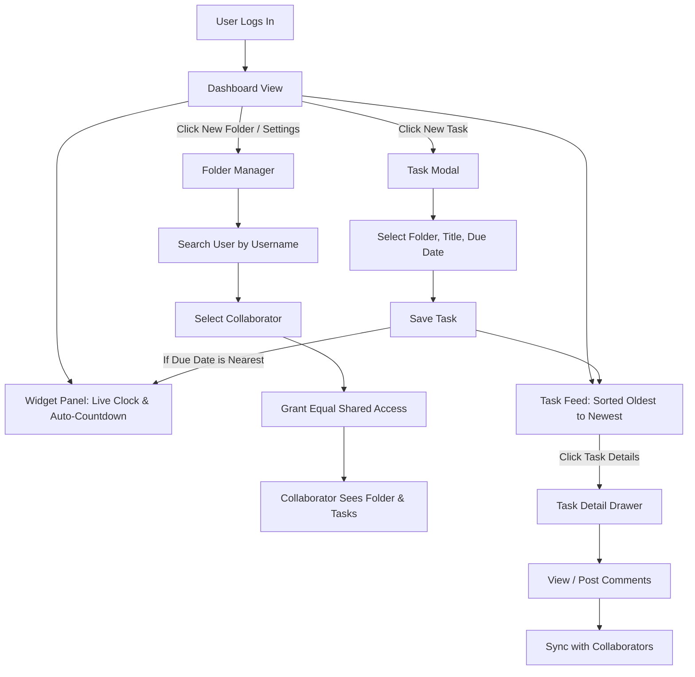
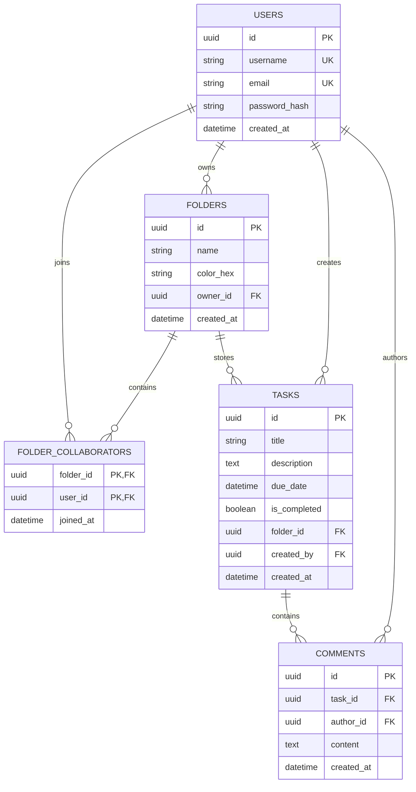

## Requirements Analysis Summary

### Problem Statement & Context

College students struggle to manage overlapping assignment deadlines across multiple courses and team projects. Existing productivity software is either too complex for simple student workflows (e.g., enterprise project management tools) or lacks collaborative features tailored to coursework (e.g., basic offline to-do apps).

**AcademiaTask** addresses this gap by combining course-based folder organization, peer collaboration via shared folders, a task-level discussion system, and an integrated academic time-management dashboard (clock, Pomodoro timer, stopwatch, and automatic nearest-deadline countdown).

### Target Audience & Core Needs

* **Primary User:** Undergraduate/Graduate College Students managing individual coursework and deadlines.
* **Secondary User:** Student Group Project Collaborators sharing joint tasks and deadlines.
* **Key Needs:** Centralized deadline visibility, sorting tasks from oldest to newest due date, effortless username-based collaboration, and built-in focus tools without context switching.

### Scope & Constraints Summary

* **Architecture:** Next.js (Full-stack Web App) with SQL Database (Relational Data Model).
* **Delivery Context:** Course Project / Academic Portfolio MVP.
* **Collaboration Model:** Equal co-working permissions (Option 1) for all collaborators in a shared folder (create, edit, complete, delete tasks).
* **Key Differentiation:** Integrated time management suite with an automated, dynamic countdown targeting the user's single nearest upcoming assignment.

---

# Product Requirements Document (PRD)

## 1. Document Information

* **Product Name:** AcademiaTask
* **Document Version:** 1.0.0 (MVP)
* **Status:** Approved for Implementation
* **Date:** October 15, 2026
* **Prepared By:** Product Management & Business Analysis Lead

---

## 2. Executive Summary

AcademiaTask is a web-based academic task management and productivity platform designed specifically for college students. It solves the fragmentation of academic workflows by unifying personal task tracking, shared course/group project folders, task-specific peer discussions, and built-in focus widgets (including an automated nearest-deadline countdown). Built using Next.js and SQL, the MVP focuses on fast task entry, clear visual organization, and seamless peer collaboration via username lookup.

---

## 3. Background and Problem Statement

Students frequently balance 4–6 courses per term, each with distinct assignments, group projects, and deadlines. Current solutions present three main problems:

1. **High Overhead:** Enterprise project management tools require extensive setup and maintenance.
2. **Lack of Academic Context:** Generic to-do apps lack built-in focus tools (Pomodoro timers) and urgent deadline prioritization.
3. **Friction in Group Work:** Sharing tasks across study groups often requires full platform onboarding or complicated email invitations.

AcademiaTask eliminates these pain points by offering lightweight, course-structured task organization, instant peer sharing via direct username search, and automated urgency tracking.

---

## 4. Product Vision and Objectives

* **Product Vision:** To be the default, frictionless academic workspace where college students organize coursework, collaborate with classmates, and manage study time effectively.
* **Business/Academic Objectives:**
* Deliver a fully functional, zero-critical-bug full-stack web application within the course evaluation timeline.
* Achieve modern web standards for performance (PageSpeed Score >= 90) and accessibility.


* **User Objectives:**
* Reduce time spent organizing weekly tasks to under 3 minutes per day.
* Eliminate missed deadlines through clear chronological sorting and auto-countdowns.
* Enable 1-click collaboration with peers using simple username searches.


---

## 5. Target Users and Personas

| Attribute | Primary Persona: Alex (Individual Student) | Secondary Persona: Jordan (Group Project Lead) |
| --- | --- | --- |
| **Role** | 2nd-year CS Student taking 5 courses | 4th-year Business Student leading a capstone group |
| **Goals** | Keep track of daily assignments; avoid late submissions; run focused study sessions | Organize group deliverables; assign tasks to peers; keep discussion in one place |
| **Frustrations** | Forgets deadlines buried in course syllabi; tab-switches between timer apps and to-do lists | Chatting about tasks in messy messaging apps where details get lost |
| **Key Tech Behavior** | Desktop web browser during study sessions; prefers clean, fast interfaces | Daily active web browser user; heavy collaborator |

---

## 6. Scope

### In Scope (MVP)

* User registration, secure authentication, and profile management (username based).
* Task CRUD (Create, Read, Update, Delete) with Title, Due Date, Folder/Course, and Description.
* Default chronological task list view sorted from **oldest due date to newest due date**.
* Task queue sorting by deadline or deadline-derived priority (overdue, high within 24 hours, medium within 7 days, then low).
* Folder CRUD (e.g., "CS 101", "Biology Lab") to group tasks.
* Username search engine to invite peers to shared folders.
* Shared folder co-working model: Invited users get equal access (create, edit, complete, delete tasks within the shared folder).
* Task-level comment stream accessible to folder owners and collaborators.
* Interactive Widget Dashboard:
* Live digital clock display.
* Stopwatch / standard timer.
* Pomodoro focus timer (25 min work / 5 min break).
* **Automatic Countdown Widget:** Automatically calculates and displays time remaining until the user's next pending assignment due date.


### Out of Scope (Future Versions)

* Direct integration with Learning Management Systems (Canvas, Blackboard, Moodle API sync).
* Native mobile applications (iOS / Android).
* File attachments/uploads in task comments.
* Real-time WebSocket notifications (MVP uses HTTP polling or page refresh triggers).
* Recurring task rules (e.g., "Repeat every Tuesday").

---

## 7. Functional Requirements

### 7.1 User Authentication & Search

#### Requirement ID: FR-AUTH-001

* **Feature Name:** User Account Registration & Unique Username Setup
* **Description:** Allows students to register using an email, password, and a mandatory unique username.
* **User/Business Value:** Unique usernames enable peer-to-peer search and folder sharing without revealing private emails.
* **Preconditions:** User is on the landing/login page.
* **Expected Behavior:** System validates email format, checks username uniqueness in real time, hashes password, and creates account session.
* **Acceptance Criteria:**
* User cannot register if username is already taken.
* Username must be alphanumeric (3–20 characters, no special characters except underscores).


* **Priority:** Must Have
* **Dependencies/Edge Cases:** Unique constraint on `users.username` in SQL database.

#### Requirement ID: FR-AUTH-002

* **Feature Name:** Peer Username Search Engine
* **Description:** An input field allowing logged-in users to search for existing registered users by exact or partial username.
* **User/Business Value:** Enables quick collaborator discovery for shared folders.
* **Preconditions:** User is logged in and viewing folder settings or modal.
* **Expected Behavior:** Typing 2+ characters triggers a query returning matching user handles and avatars.
* **Acceptance Criteria:**
* Current logged-in user is excluded from search results.
* Returns up to 5 best matching active accounts.


* **Priority:** Must Have
* **Dependencies/Edge Cases:** Search rate-limiting; handling zero results gracefully.

---

### 7.2 Folder & Task Management

#### Requirement ID: FR-FOLD-001

* **Feature Name:** Course/Folder Management & Sharing
* **Description:** Users can create folders to group tasks and invite peers via username search.
* **User/Business Value:** Provides logical structure for coursework and shared project spaces.
* **Preconditions:** User is logged in.
* **Expected Behavior:** Folder created -> User can add collaborators by username -> Invited user sees folder appear in their workspace instantly.
* **Acceptance Criteria:**
* Folder creator and all invited collaborators have full co-working access (Option 1 model: equal rights to create, edit, check off, and delete tasks within that folder).
* User can remove themselves from a shared folder.


* **Priority:** Must Have
* **Dependencies/Edge Cases:** SQL foreign keys linking folders and user collaborator junction tables.

#### Requirement ID: FR-TASK-001

* **Feature Name:** Task CRUD & Deadline/Priority Sorting
* **Description:** Create, read, update, complete, and delete tasks assigned to specific folders with mandatory due dates.
* **User/Business Value:** Core productivity mechanics; ensures students prioritize urgent work first.
* **Preconditions:** User has at least one folder created or uses default "General" folder.
* **Expected Behavior:** Tasks default to **oldest due date to newest due date** and can be switched to deadline-derived priority order: overdue first, then deadlines within 24 hours, within 7 days, and later.
* **Acceptance Criteria:**
* Task fields required: `Title`, `Due Date & Time`, `Folder`. Optional: `Description`.
* The Task Queue sort control offers Deadline and Priority; priority is inferred from the deadline and is not a separately saved task field.
* Completed tasks move to a collapsible "Completed" section at the bottom of the list.
* Overdue tasks highlight in visual red alert state.
* Users can move a task to any folder they can access. Moving it preserves its task identity and associated attachments, comments, and breakdown state.


* **Priority:** Must Have
* **Dependencies/Edge Cases:** Timezone handling (store dates in UTC, display in user local time).

---

### 7.3 Task Discussions

#### Requirement ID: FR-COMM-001

* **Feature Name:** Task-Level Comments
* **Description:** A thread attached to every task where folder members can post text notes and updates.
* **User/Business Value:** Replaces external chat apps for task-specific questions and updates.
* **Preconditions:** User has access to the folder containing the task.
* **Expected Behavior:** Opening a task opens a side-panel or modal showing chronological comment stream with author username and timestamp.
* **Acceptance Criteria:**
* Only users with folder access can view or write comments.
* Comment author can delete their own comment.


* **Priority:** Must Have
* **Dependencies/Edge Cases:** Empty comment state display; plain text sanitation (XSS prevention).

---

### 7.4 Dashboard Focus Widgets

#### Requirement ID: FR-WIDG-001

* **Feature Name:** Multi-Mode Clock & Timer Suite
* **Description:** Header/sidebar widget containing Live Clock, Stopwatch, Pomodoro Timer (25m work / 5m break), and Automated Deadline Countdown.
* **User/Business Value:** Keeps students focused and aware of immediate time constraints without leaving the app.
* **Preconditions:** Dashboard page loaded.
* **Expected Behavior:**
* **Live Clock:** Shows current local time (HH:MM:SS AM/PM).
* **Pomodoro:** Play/Pause/Reset controls with audio chime on cycle complete.
* **Auto-Countdown:** System queries SQL database for the single uncompleted task with the `due_date >= NOW()` closest to current time and renders a live dynamic countdown (`X Days, Y Hours, Z Mins`).


* **Acceptance Criteria:**
* If no uncompleted future tasks exist, countdown widget displays "No upcoming deadlines!".
* Completing the nearest task instantly updates the auto-countdown to target the *next* chronological task.


* **Priority:** Must Have
* **Dependencies/Edge Cases:** Client-side interval sync with server timestamp to avoid drift.

---

## 8. User Stories and Use Cases

### User Story 1: Peer Folder Collaboration

* **As a** student working on a group assignment,
* **I want to** search for my teammate by their username and add them to my "CS Project" folder,
* **So that** we can both manage, edit, and check off our shared project tasks in one place.

#### Acceptance Criteria (Given-When-Then):

* **Given** I am on the folder settings modal for "CS Project",
* **When** I type "jordan_dev" into the peer search bar and click "Add to Folder",
* **Then** "jordan_dev" should appear in the folder collaborator list, and the folder should instantly show up in Jordan's folder drawer.

---

### User Story 2: Automated Urgent Deadline Countdown

* **As a** busy college student,
* **I want to** see an automatic live countdown to my next impending assignment deadline on my dashboard,
* **So that** I know exactly how much time I have left without manually calculating dates.

#### Acceptance Criteria (Given-When-Then):

* **Given** I have a task "Math Homework" due tomorrow at 5:00 PM and "Essay" due in 3 days,
* **When** I view my dashboard clock widget,
* **Then** the Automatic Countdown widget must target "Math Homework" and display dynamic remaining time down to minutes/seconds.
* **When** I check off "Math Homework" as complete,
* **Then** the widget immediately updates to target "Essay".

---

## 9. User Journeys and Workflows



---

## 10. Information Architecture

```
AcademiaTask Architecture
├── Authentication
│   ├── /login
│   └── /register
└── Dashboard App Layout (Protected)
    ├── Main Sidebar Navigation
    │   ├── All Tasks (Default Chronological View)
    │   ├── Folders List
    │   │   ├── [Personal Folders]
    │   │   └── [Shared Folders (Badge Indicator)]
    │   └── + Create New Folder Button
    ├── Main Content Workspace
    │   ├── Top Header: Time Widget Bar (Clock | Pomodoro | Auto-Countdown)
    │   ├── Task Action Bar (Add Task | Sort/Filter Controls)
    │   └── Task List View (Grouped by Today, Upcoming, Completed)
    └── Task Detail Drawer (Slide-out)
        ├── Task Fields (Title, Due Date, Folder Selector, Status Checkbox)
        ├── Description Field
        └── Discussion Stream (Comment Input & Historical Thread)

```

---

## 11. Non-Functional Requirements

| Category | Requirement | Metric / Standard | Proposed Target |
| --- | --- | --- | --- |
| **Performance** | Page Load Time | First Contentful Paint (FCP) | < 1.2 seconds |
| **Performance** | API Response Time | Next.js Server Actions / SQL Query | < 200 ms |
| **Security** | Password Hashing | Encryption Standard | bcrypt / Argon2id |
| **Security** | Data Access | Row Level Authorization | Users can only access tasks in owned/collaborated folders |
| **Accessibility** | Usability Standards | WCAG 2.1 Level | AA Compliance (High contrast, keyboard navigation) |
| **Responsiveness** | UI Adaptability | Viewport Support | Mobile (375px) to Desktop (1920px) responsive |
| **Data Integrity** | Cascade Rules | SQL Foreign Key Actions | Deleting a folder prompts choice to delete or migrate tasks |

---

## 12. Data and Integrations

### 12.1 Database Schema Diagram (Entity Relationship)



---

## 13. UI/UX Requirements

* **Sorting & Visual Hierarchy:** The default task view MUST sort tasks chronologically (oldest due date first), with an optional priority view grouped by deadline urgency. Tasks due within 24 hours feature a subtle amber highlight; overdue tasks render with a red badge.
* **Widget Ergonomics:** The clock and Pomodoro timer widgets are pinned to the top header for persistent access across all folder views.
* **Empty States:**
* *No Tasks:* Display an encouraging graphic with a prominent "+ Add First Task" button.
* *No Comments:* Display "No comments yet. Start the conversation with your study group!"


* **Loading & Feedback States:** UI buttons show inline spinners during Next.js Server Action execution; optimistic updates used for checking off tasks for instant visual gratification.

---

## 14. Analytics and Success Metrics

For academic evaluation and portfolio demonstration, key success metrics will be validated through automated tests and user testing:

| Metric Name | Calculation Method | Target Threshold |
| --- | --- | --- |
| **Task Creation Velocity** | Time from clicking "+ New Task" to submission | < 8 seconds |
| **Chronological Precision** | Automated test verification of task sorting query | 100% compliance |
| **Auto-Countdown Accuracy** | Time offset between countdown zero and UTC server due date | < 1 second drift |
| **Lighthouse Performance** | Automated Chrome DevTools Audit Score | >= 90 / 100 |

---

## 15. Risks, Dependencies, and Assumptions

### Risks & Mitigations

* **Risk:** Edge-case timezone discrepancies between browser local time and server UTC due dates causing inaccurate countdowns.
* *Mitigation:* Convert all stored dates to UTC in PostgreSQL; perform client-side localization using standard JavaScript `Intl` API.


* **Risk:** Race conditions during concurrent task edits in shared co-working folders.
* *Mitigation:* Use atomic SQL update queries and revalidate Next.js cache path tags upon database writes.


### Project Assumptions

* Users have access to modern evergreen web browsers (Chrome, Firefox, Edge, Safari).
* All project collaborators register accounts on the platform using a unique username.

---

## 16. Release Plan

```
Phase 1: Foundation (Days 1–3)
├── Setup Next.js App Router + SQL DB Schema (Prisma/Drizzle)
└── Implement Auth System (Login, Registration, Unique Username Validation)

Phase 2: Core Task & Folder Engine (Days 4–7)
├── Folder CRUD & Personal Workspaces
├── Task CRUD with mandatory Due Date fields
└── Chronological Sorting Engine (Oldest to Newest SQL Query)

Phase 3: Collaboration & Social Features (Days 8–10)
├── Peer Search API (Search users by username)
├── Shared Folder Permissions Engine (Option 1 Co-working Model)
└── Task Comment Stream Components

Phase 4: Focus Suite & UI Polish (Days 11–13)
├── Clock / Timer / Pomodoro Widget UI
├── Automated Nearest-Deadline Countdown Logic
└── Empty States, Responsive Layouts & Accessibility Polish

Phase 5: QA & Final Release (Day 14)
└── End-to-End Testing, Bug Fixes, and Project Submission Demo

```

---

## 17. Acceptance and Sign-Off

The MVP release candidate is considered ready for final submission when:

1. All **Must Have** functional requirements (FR-AUTH-001 through FR-WIDG-001) pass manual user testing.
2. SQL migrations execute cleanly without foreign key conflict errors.
3. Automated tests confirm tasks sort reliably from oldest due date to newest due date.
4. Auto-countdown widget accurately updates upon creation or completion of nearest tasks.

---

## 18. Appendices

### Glossary

* **MVP:** Minimum Viable Product—the core, functional feature set required for initial evaluation.
* **Pomodoro Technique:** Time-management method using 25-minute focused work intervals separated by 5-minute short breaks.
* **Co-working Model (Option 1):** Permission structure where all invited folder members hold equal editing and administrative privileges over contained tasks.